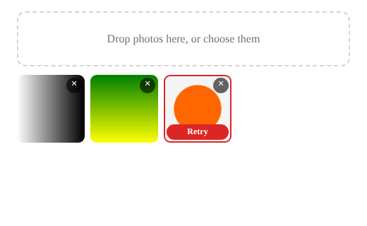

# uploader-core

_Working name._ Compresses images in the browser, then uploads them straight to your own bucket
(S3, Cloudflare R2, or anything S3-compatible). No files pass through your server, and there's no
service in between. Pulled out of Do//Eat.

```ts
import { compress, upload } from 'uploader-core';

const small = await compress(file, { maxWidth: 2048, maxHeight: 2048, quality: 0.8, format: 'webp' });
const { key } = await upload(small, { presign: '/api/presign', onProgress: (p) => (progress = p) });
// Save `key` in your database.
```

Your server needs one small endpoint that signs the upload:

```ts
// e.g. src/routes/api/presign/+server.ts in SvelteKit
import { presignS3, PresignRefused } from 'uploader-core/server';

export async function POST({ request }) {
	try {
		return Response.json(
			await presignS3(
				{ bucket: 'photos', region: 'auto', endpoint: R2_ENDPOINT, accessKeyId, secretAccessKey },
				{ key: `uploads/${crypto.randomUUID()}`, request: await request.json(), maxBytes: 5_000_000 }
			)
		);
	} catch (e) {
		if (e instanceof PresignRefused) return new Response(e.message, { status: 400 });
		throw e;
	}
}
```

Check who's asking before you sign: the endpoint is yours, and so is its auth.

## `compress(file, options?)`

`compress` never throws on a bad file. A file that isn't an image, or that the browser can't decode,
comes back as the same `File` object, so `out === file` tells you nothing ran.

| Option      | Default   | What it does                                                                 |
| ----------- | --------- | ---------------------------------------------------------------------------- |
| `maxWidth`  | `1200`    | The output fits inside `maxWidth` × `maxHeight`, keeping its aspect ratio. It's never scaled up. |
| `maxHeight` | `1200`    |                                                                              |
| `quality`   | `0.85`    | JPEG/WebP quality, from 0 to 1.                                              |
| `maxBytes`  | `500_000` | An image already inside the box and under this size is passed through untouched. `0` always re-encodes. |
| `format`    | (source)  | `'jpeg'`, `'png'` or `'webp'`. If unset, it keeps the source's type when canvas can encode it, otherwise it uses JPEG. WebP falls back to JPEG where the browser can't encode it. |

- **Orientation:** decoding goes through an ``, which applies EXIF orientation, so phone photos
  come out upright.
- **Metadata:** re-encoding drops EXIF, including GPS.
- **Transparency:** a PNG stays a PNG and keeps its alpha channel unless you ask for JPEG.
- **HEIC:** a browser that can decode it (Safari) gets a JPEG back. Other browsers get the file back unchanged.
- **Never worse:** if an image is already inside the box, it's only re-encoded when that makes it
  smaller. Otherwise you get the original back.
- **Lazy:** Pica is loaded on the first `compress()` call.

## `upload(file, options)`

It asks for a presigned target once, then PUTs the file there over XHR, which reports progress
everywhere. It resolves to `{ key, bytes, type }`.

| Option           | What it does                                                                  |
| ---------------- | ----------------------------------------------------------------------------- |
| `presign`        | A URL, which gets a JSON POST of `{ contentType, size, name }` and answers with the target, or a function that returns the target itself. |
| `presignHeaders` | Headers for the presign request, such as `Authorization`.                     |
| `onProgress`     | Called with 0 to 1 as bytes go out.                                           |
| `signal`         | An `AbortSignal`. Aborting stops the upload where it is.                      |
| `retries`        | Tries after the first, default `2`. Only a dropped connection, a 5xx or a 429 is retried, with backoff (0.5s, 1s, …). A refusal (403 and the like) fails at once. |

A failure throws `UploadError`, with `status` set to the HTTP status (absent for a network error).
An abort throws the signal's reason, an `AbortError` by default.

## `presignS3(config, options)` (from `uploader-core/server`)

It makes a presigned PUT, signed with AWS Signature V4 on WebCrypto alone, so it runs on Node,
Deno, Bun and edge runtimes. The signature covers the content type and the exact size the client
declared.

- **`config`:** `{ bucket, region, accessKeyId, secretAccessKey, endpoint? }`. Leave `endpoint` unset
  for AWS. For R2, use `region: 'auto'` and `endpoint: 'https://<account>.r2.cloudflarestorage.com'`.
- **`options`:** `{ key, request, maxBytes, accept?, expiresIn? }`. `request` is what the client sent.
  `accept` defaults to any `image/*`. `expiresIn` defaults to 300 seconds.
- It throws `PresignRefused` for a size over `maxBytes`, a type `accept` turns down, or a missing size.

**Size limits:** S3 refuses a file whose size isn't the one signed. R2 doesn't enforce the signed
size, so there the `maxBytes` check is what holds, and it trusts the size the client declared.

**CORS:** the browser PUTs to the bucket directly, so the bucket has to allow it:

```json
[{ "AllowedOrigins": ["https://your.app"], "AllowedMethods": ["PUT"], "AllowedHeaders": ["Content-Type"] }]
```

Why PUT and not a presigned POST: R2 and Backblaze B2 don't support POST uploads, and one path
covers every provider.

## `<photo-upload>` (from `uploader-core/element`)

A drop-in element for picking, dropping or pasting photos. Each one is compressed and uploaded,
three at a time.

```html
<script type="module">
	import 'uploader-core/element';
	import 'uploader-core/element.css'; // optional default look
</script>

<photo-upload presign="/api/presign" multiple max-files="10"></photo-upload>
```



```js
document.querySelector('photo-upload').addEventListener('complete', (e) => {
	save(e.detail.key); // also: file, bytes, type, originalBytes
});
```

| Attribute       | Default   | What it does                                     |
| --------------- | --------- | ------------------------------------------------ |
| `presign`       |           | The presign endpoint's URL. To pass a function, set the `presign` property instead. Set `presignHeaders` for auth. |
| `accept`        | `image/*` | As on `<input type="file">`.                     |
| `multiple`      |           | Allows more than one file per pick.              |
| `max-files`     |           | The most files it holds at once.                 |
| `max-dimension` | `2048`    | The longest side after compressing.              |
| `quality`       | `0.82`    |                                                  |
| `format`        | (source)  | `jpeg`, `png` or `webp`.                         |

**Events** (they bubble): `add`, `progress` (`{ file, progress }`), `complete` and `error`
(`{ file, error }`, for a refused type, too many files, or a failed upload). **Methods:** `add(files)`
and `clear()`.

### Styling it

It renders into the light DOM with no classes of its own, so any CSS reaches it. You select its
parts with `data-part` and its state with `data-state`:

```html
<photo-upload data-state="idle | dragging | busy" data-count="2">
	<label data-part="dropzone">
		<input data-part="input" type="file" />
		<span data-part="prompt"><!-- your children, or a line of text --></span>
	</label>
	<ul data-part="files">
		<li data-part="file" data-state="queued | compressing | uploading | done | error" data-progress="0.42" style="--progress: 0.42">
			 <span data-part="name">…</span> <progress data-part="progress"></progress>
			<button data-part="retry">Retry</button> <button data-part="remove">Remove</button>
		</li>
	</ul>
</photo-upload>
```

- **Plain CSS:** `photo-upload [data-part=file][data-state=error] { … }`
- **Tailwind:** arbitrary variants on the element, such as
  `class="[&_[data-part=dropzone]]:border-dashed data-[state=dragging]:bg-blue-50"`.
- **The default stylesheet** is in `@layer uploader`, so any of your CSS outside a layer overrides it.
  **With Tailwind v4**, name the layer order before importing Tailwind, or preflight (in `@layer base`)
  resets the element's buttons and lists:
  `@layer theme, base, uploader, components, utilities;`
  To adjust it instead of replacing it, set its custom properties: `--uploader-accent`, `--uploader-ink`,
  `--uploader-muted`, `--uploader-line`, `--uploader-surface`, `--uploader-error`, `--uploader-radius`
  and `--uploader-tile`. They follow the page's `color-scheme` for light and dark.

Importing `uploader-core/element` during server rendering is safe: it only defines the element in a browser.

## `presignSupabase(bucket, options)` (from `uploader-core/supabase`)

It makes a target in Supabase Storage from a signed upload URL. It needs only the bucket you
already have, `supabase.storage.from('photos')`, so the package doesn't depend on supabase-js.

The signed URL's token is the whole authorization, and it's good for two hours. That means this
runs wherever your Supabase client does:

- **In the browser, under the user's session:** your bucket's RLS policies decide which paths they
  may sign. No endpoint is needed.

  ```ts
  import { upload } from 'uploader-core';
  import { presignSupabase } from 'uploader-core/supabase';

  const bucket = supabase.storage.from('photos');
  const { key } = await upload(file, {
  	presign: (request) =>
  		presignSupabase(bucket, { key: `${userId}/${crypto.randomUUID()}`, request, apikey: SUPABASE_ANON_KEY })
  });
  ```

- **On the server, with a service key:** in an endpoint, as with `presignS3`.

- **`options`:** `{ key, request, maxBytes?, accept?, cacheControl?, upsert?, apikey? }`.
  `cacheControl` is in seconds, default 3600 as in supabase-js. `upsert` defaults to false. Pass
  `apikey` (the project's anon key) if your gateway requires one.

**Size and type limits:** the bucket's own file size limit and allowed MIME types are enforced on
the upload itself. `maxBytes` and `accept` refuse before anything is signed.

The upload is a raw PUT, the same request supabase-js's `uploadToSignedUrl` makes for a body that
isn't a Blob, and Storage takes it outside its JWT check. Unlike `supabase.storage.upload()`, it
reports progress, retries and can be aborted. It does cost one extra request to sign.

## Development

```sh
npm install
npm run check          # types
npm run test:unit      # node --test: sizing, accept lists, SigV4 (against AWS's example and the AWS SDK), presignS3, presignSupabase (against storage-js)
npm run test:browser   # bundles with esbuild, runs Playwright: compress, upload and the element against a faked bucket
sh test/make-fixtures.sh   # regenerate fixtures (ImageMagick + Pillow)
npm run site:serve     # build the docs and demo site into site/dist and serve it on :4173
npx playwright test -c site/playwright.config.ts   # the site's own checks
```

The site deploys to Vercel as configured in `vercel.json`. Its demo uploads to a service worker
(`site/public/sw.js`) rather than a bucket, so visitors' photos stay in their browser.
